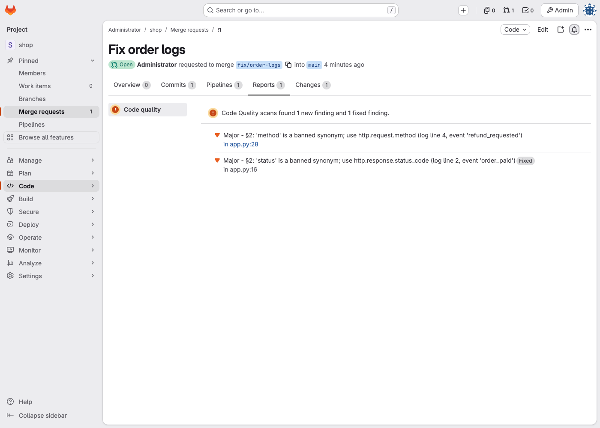

# Connecting a project to logwarden

Four steps: install, capture logs, check in CI, set up agents. Each step is independent,
and most projects need about 10 lines of config. A source linter (§6) is a recommended
addition.

## 1. Install

```bash
uv add --dev logwarden          # Python projects: CLI + pytest capture plugin
pipx install logwarden          # or a global CLI
uvx logwarden check logs.jsonl  # or no install at all (needs uv)

logwarden init --agent          # logwarden-fields.yaml + a logwarden section in AGENTS.md
```

Weaver, which does the actual checking, and the OpenTelemetry semantic conventions are
downloaded on first run into the user cache directory (`logwarden setup` does it ahead of
time). After that, checks work offline. Set `WEAVER` to use your own binary. No internet
access in CI? See [Without internet access](#without-internet-access).

**No Python on the machine?** Use the Docker image, which has Weaver and the semantic
conventions inside:

```bash
docker run --rm -v "$PWD:/work" ghcr.io/ingeniator/logwarden:0.8.1 check logs.jsonl
```

### Without internet access

Two things need the network, and they are separate:

- **Installing logwarden**, from PyPI or the image registry. The package is pure Python with
  no dependencies, so an internal PyPI mirror is enough.
- **Weaver and the semantic conventions**, downloaded from GitHub on the first `check`. This is
  what fails inside a closed network. Pick one:
  1. **The Docker image**, mirrored into your registry. Both are inside it; nothing is
     downloaded at run time. On GitLab, use the [CI template](#gitlab-ci).
  2. **A prepared cache.** Run `LOGWARDEN_CACHE=/opt/logwarden logwarden setup` once where
     GitHub is reachable, copy `/opt/logwarden` to the machines or runner image, and set
     `LOGWARDEN_CACHE=/opt/logwarden` there. The cache holds the binary for that machine's OS
     and CPU.
  3. **Your own copies.** Set `WEAVER` to a Weaver binary (v0.28.0) and `LOGWARDEN_SEMCONV` to
     the `model` directory of semantic-conventions v1.45.0.

## Node, Go, Java: setup recipes

Logger configuration whose output passes the check, each with a runnable example that CI
checks: [Node (pino)](recipes/node.md), [Go (`log/slog`)](recipes/go.md),
[Java (logback)](recipes/java.md). Other languages: write one JSON object per line with the
fields in §3 of the standard, or send logs over OTLP (below).

## Python: make compliant logs the default

Optional. logwarden checks whatever JSON your logger writes, and the pytest capture plugin
(§2) uses your app's own formatter, so a service with a tuned logging setup keeps it. Use
`configure()` for new services, or where the existing setup fails the check.

```bash
uv add 'logwarden[structlog]'
```

```python
from logwarden.logging import configure, extract_error_code, extract_error_message
log = configure(service_name="billing-api", service_version="1.4.2", environment="production")

except httpx.HTTPStatusError as e:
    log.error("upstream_call_failed", exc_info=True,
              upstream_error_message=extract_error_message(e.response),
              **{"server.address": e.request.url.host,
                 "http.response.status_code": e.response.status_code,
                 "error.type": extract_error_code(e.response) or type(e).__name__})
```

`configure()` adds the required fields, trace context, `exception.*` fields and redaction,
and routes third-party loggers through the same JSON formatter (run uvicorn with
`log_config=None`). Name, version and environment can come from `OTEL_SERVICE_NAME`,
`SERVICE_VERSION` and `DEPLOYMENT_ENVIRONMENT`. A missing value or an environment like `dev`
raises at startup.

In tests, `logwarden.testing` checks the log lines a test produces:

```python
from logwarden.testing import capture, assert_failure_logged, assert_logs_clean

with capture() as logs:
    client.post("/chat")                       # the upstream is mocked to time out
assert_failure_logged(logs, "upstream_call_failed", **{"server.address": "api.openai.com"})
assert_logs_clean(logs)                        # the full logwarden check on these lines
```

## 2. Capture the logs your code produces

logwarden checks real output, so the project needs a run that produces logs: tests,
or a smoke run. Include failure cases (500s, timeouts). §10 of the standard is
about exactly those lines.

**Python / pytest.** With `logwarden` installed (as a dev dependency), the capture plugin is
registered automatically:

```bash
LOGWARDEN_CAPTURE=logs.jsonl pytest
# without adding a dependency:
LOGWARDEN_CAPTURE=logs.jsonl uv run --with logwarden pytest
```

The plugin does nothing unless `LOGWARDEN_CAPTURE` is set. It writes each log line the
service formats to that file, at `INFO` and above (`LOGWARDEN_LEVEL` changes this). It
works with structlog routed through stdlib `logging`, which is the setup in the standard.

**Containers (any language):**

```bash
docker compose up -d myservice && ./smoke-test.sh
docker compose logs --no-log-prefix --no-color myservice > logs.jsonl
```

**Anything else:** save the service's stdout to a file, or pipe it in:
`./my-service 2>&1 | logwarden check -`. Every non-blank line must be a JSON object
(`adr_non_json_line`), so capture only the service's output, not a test runner's.

**Any language with an OpenTelemetry SDK: capture over OTLP.** `logwarden capture` is an
OTLP/HTTP receiver. It writes each log record as a JSON line (resource attributes merged in,
`event` from the event name or string body, `level` from the severity, `logger` from the
instrumentation scope) and then runs the same check:

```bash
logwarden capture -o logs.jsonl -- npm test        # runs the command with OTEL_* set, then checks
logwarden capture -o logs.jsonl                    # or receive on :4318 until Ctrl-C / SIGTERM
docker run --rm -p 4318:4318 -v "$PWD:/work" ghcr.io/ingeniator/logwarden:0.8.1 capture --host 0.0.0.0
```

With a command, it sets `OTEL_EXPORTER_OTLP_ENDPOINT`, `OTEL_LOGS_EXPORTER=otlp` and the
protocol `http/protobuf` (gRPC isn't supported; an existing `http/json` setting is kept).
The exit code is the command's if it failed, otherwise the check's. The command's own stdout
goes to stderr, so `--json` output stays parseable. Traces and metrics sent to the same
endpoint are accepted and ignored.

## 3. Check in CI

GitHub Actions:

```yaml
- run: LOGWARDEN_CAPTURE=logs.jsonl uv run pytest
- uses: Ingeniator/logwarden@v0.8.1
  with:
    logs: logs.jsonl
    # fail: "false"     # report only, while a legacy service is being migrated
```

Other CI systems: `uvx logwarden==0.8.1 check logs.jsonl`. The exit code is 0 when the logs
are clean, 1 when there are violations, and 2 when setup failed.

**Migrating an existing service:** record a baseline so CI fails only on new problems,
then shrink it:

```bash
LOGWARDEN_CAPTURE=logs.jsonl pytest
logwarden baseline logs.jsonl            # writes .logwarden-baseline.json
```

```toml
[tool.logwarden]
baseline = ".logwarden-baseline.json"     # commit it with the config
```

Fix the logging setup first (it clears `adr_missing_required` on every line at once), then
the call sites. When `check` reports baseline entries that no longer occur, run
`logwarden baseline` again so the file only shrinks. A finding matches its baseline entry by
rule, field, logger and event name (numbers and ids masked), so code moving around doesn't
break it. `fail: "false"` in the Action still works for a report-only start.

### Review: compare with the base branch, PR comment, HTML report

A snapshot records what a run found. A later run compared with it reports which findings
are new and which were fixed, matched like baseline entries (so moved lines aren't new), and
which event names appeared or disappeared:

```bash
logwarden check logs.jsonl --snapshot base.json               # on the base branch
logwarden check logs.jsonl --compare base.json \
    --html report.html --markdown report.md                   # on a branch
```

`--compare` only reports; the exit code doesn't change. (To fail only on new findings, use
the baseline.) `--html` writes one self-contained page; `--markdown` writes a summary that
fits in a PR comment. `-o DIR` writes both, plus `snapshot.json`.

The GitHub Action does all of this:

```yaml
permissions:
  contents: read
  pull-requests: write          # only for comment: "true"
steps:
  - run: LOGWARDEN_CAPTURE=logs.jsonl uv run pytest
  - uses: Ingeniator/logwarden@v0.8.1
    with:
      logs: logs.jsonl
      comment: "true"
```

- **`compare: auto`** (default): on a push, the run's snapshot goes into the Actions cache;
  on a pull request, the base branch's newest snapshot is restored and compared with. The
  workflow must also run on pushes to the base branch, and comparing starts after the first
  such push. A pull request can read the base branch's cache, so no extra token is needed.
  `compare: path/to/snapshot.json` compares with a file; `compare: "false"` turns it off.
- **`comment: "true"`**: posts the Markdown summary as one comment and updates it on each
  push. Pull requests from forks get a read-only token, so there it only warns.
- **`upload`** (default `"true"`): the artifact `logwarden-report` has `report.html`,
  `report.md`, `result.json` and `snapshot.json`.
- The job summary shows the Markdown summary. Outputs: `violations`, `new`, `fixed`.
- Using the Action more than once in a job: give each use its own `snapshot-id` and
  `artifact-name`.

### GitLab CI

Copy [`ci/gitlab/logwarden.gitlab-ci.yml`](https://github.com/Ingeniator/logwarden/blob/main/ci/gitlab/logwarden.gitlab-ci.yml)
into your repository and extend its hidden job:

```yaml
include:
  - local: ci/logwarden.gitlab-ci.yml

logwarden:
  extends: .logwarden
  needs: [{job: test, artifacts: true}]     # the job that writes logs.jsonl
  variables:
    LOGWARDEN_IMAGE: registry.example.com/mirror/logwarden:0.8.1   # your copy of ghcr.io/ingeniator/logwarden
    LOGWARDEN_LOGS: logs.jsonl
```



- It runs the Docker image, which has Weaver and the semantic conventions inside, so the job
  needs no internet access. Mirror the image into your registry and pin it by digest if you like.
- `--codequality` writes a [Code Quality report](https://docs.gitlab.com/ci/testing/code_quality/):
  the merge request's Reports tab lists new and resolved findings (every tier); Ultimate also
  marks them in the diff. Findings sit on the source line when the lines have `code.file.path`
  and `code.line.number` (see SARIF below), else on their line in the log file.
- `logwarden-report/` has `report.html` (linked from the merge request), `report.md` compared
  with the target branch's snapshot, and `snapshot.json` for the next comparison.
- Violations are an allowed failure (`allow_failure: exit_codes: [1]`): the pipeline passes with
  a warning. A broken setup, exit 2, still fails. Remove `allow_failure` to make it a gate.
- `LOGWARDEN_ARGS` passes more options, such as `--source-root /app` or `--message-field log`.
- To post `report.md` as a merge-request note, call the Notes API with a token that has the
  `api` scope; the job token can't post notes.

### Findings on the source line (SARIF)

`check --sarif FILE` writes the findings as [SARIF](https://sarifweb.azurewebsites.net/), so
GitHub code scanning (and other SARIF viewers) show each one on the line of code that logged
it. That works when log lines say where they were logged, in the semconv fields
`code.file.path`, `code.line.number` and `code.function.name`:

- **Python:** `configure(..., callsite=True)`, or `LOGWARDEN_CALLSITE=1`. The pytest plugin
  sets it while capturing, so test logs have the fields with no code change.
- **Go:** the recipe turns on slog's `AddSource` and maps it to the three fields.
- Other languages: add the fields in the shared formatter if the logger provides the call site.

A finding without a location is placed on its line in the log file instead. Paths are made
relative to the repository: an absolute path under the current directory is shortened, and
`--source-root /build/dir` removes a build-time prefix.

```yaml
permissions:
  contents: read
  security-events: write        # for sarif: "true"
steps:
  - run: LOGWARDEN_CAPTURE=logs.jsonl uv run pytest
  - uses: Ingeniator/logwarden@v0.8.1
    with:
      logs: logs.jsonl
      sarif: "true"
```

`lint-code --sarif FILE` does the same for the source rules. Upload it in its own step:

```yaml
  - run: uvx logwarden==0.8.1 lint-code --sarif lint.sarif src/ || true
  - uses: github/codeql-action/upload-sarif@v3
    with: {sarif_file: lint.sarif, category: logwarden-lint-code}
```

Code scanning is free on public repositories; private ones need GitHub Advanced Security.
Without `security-events: write`, the Action's upload step warns and the check still decides
the job's result.

## 4. Project config and project-only fields

```toml
# pyproject.toml (or the same keys at top level in logwarden.toml)
[tool.logwarden]
fields = "logwarden-fields.yaml"
```

```toml
baseline = ".logwarden-baseline.json"             # optional, see "Migrating" above
disable = { adr_sensitive_data = "user.email is required by the audit log (SEC-12)" }
```

```toml
upstreams = ["api.openai.com", "api.anthropic.com"]   # each needs a failure test
```

```toml
events = "logwarden-events.toml"      # event catalog: every event must be listed
```

`upstreams` lists the hosts the service calls. `check` fails when a test run has no failure
line for one of them (`adr_upstream_failure_coverage`).

`events` names the event catalog: the event names the service logs, each with a
description. `check` reports an event that isn't listed (`adr_event_catalog`), so new and
renamed events become a reviewed change; dashboards and alerts match on these names.
`logwarden catalog logs.jsonl` lists the events of a run (`--markdown` for docs), and
`logwarden catalog logs.jsonl -o logwarden-events.toml` creates the file or adds new
events to it, keeping existing entries and descriptions:

```toml
[events.order_imported]
description = "An order file was parsed and stored."
levels = ["info"]
```

```toml
[source]                              # how to read the input (exports, log shippers)
message_field = "log"                 # the service's JSON line is in this field
ignore_fields = ["kubernetes", "stream", "@timestamp", "time", "_p"]
service_field = "service.name"        # for the per-service breakdown (default)
format = "auto"                       # or jsonl, es, csv
```

`[source]` is described in [§7](#7-production-logs-kibana-and-elasticsearch-exports).

`disable` switches a rule off for this project. Each rule needs a reason, and disabled
rules are listed with their reasons in every result.

`fields` lists fields only this service logs. When there's no config, `./logwarden-fields.yaml`
is used if it exists. The template that `logwarden init` creates explains the format and
when a field belongs there. Fields that several services share go into logwarden's
shared registry instead, through a PR to this repo.

The order of precedence is `--fields`, then `$LOGWARDEN_FIELDS`, then the config, then
`./logwarden-fields.yaml`. Unknown config keys produce a warning.

## 5. AI agents

Agents should check the logs of the code they write, the same way they run tests.

| Agent | Setup |
|---|---|
| Claude Code | `/plugin marketplace add Ingeniator/logwarden`, then `/plugin install logwarden@logwarden`. This gives the skill, the MCP server (via `uvx`, so uv must be installed) and `/logwarden:check` |
| Other agents (Codex, Cursor, …) | `logwarden init --agent` adds a logwarden section to `AGENTS.md`. For MCP: `uvx --from 'logwarden[mcp]' logwarden mcp` |

MCP tools: `check_logs(path | lines)`, `explain_rule(rule_id)`, `list_rules()`,
`get_standard()`. Agents with shell access can use `logwarden check --json` instead. Both
give the same result.

The skill tells the agent to fix findings in its own changes, never silence them,
and not to rewrite unrelated legacy logging unless asked.

## 6. Lint the source too (recommended)

logwarden checks the logs a run produces, so it only sees code paths that ran. A source
linter catches some of the same mistakes in every file, before anything runs. Run both:
the linter in your normal lint step, and logwarden on the captured logs.

**Any language: `logwarden lint-code`** runs logwarden's [Semgrep](https://semgrep.dev)
rules on Python, JavaScript/TypeScript, Go and Java:

```bash
logwarden lint-code src/                     # exit 0 clean, 1 findings, 2 setup error
logwarden lint-code --json src/              # for CI tools and agents
logwarden lint-code --exclude-rule logwarden-print-python src/
```

| Rule (one per language: `-python`, `-js`, `-go`, `-java`) | Catches | Runtime rule it prevents |
|---|---|---|
| `logwarden-event-name-*` | a formatted or non-snake_case log message (`f"..."`, `%`, `.format`, `+`, template literal, `fmt.Sprintf`, `String.format`, `"Imported {} rows"`) | `adr_event_name` |
| `logwarden-sensitive-key-*` | a field named like `password`, `token`, `api_key` | `adr_sensitive_data` |
| `logwarden-banned-key-*` | a banned synonym as a field name (`error=`, `"err"`, `kv("status", ...)`) | `adr_banned_synonym` |
| `logwarden-print-*` | `print`, `console.log`, `fmt.Println`, `System.out.println` (warning; skips tests, scripts and `cli.py`) | `adr_non_json_line` |

Semgrep isn't a dependency of logwarden (it pins its own OpenTelemetry and `mcp` versions).
`lint-code` uses `semgrep` from `PATH`, or runs it with `uvx` in its own environment when uv
is installed. Semgrep has no native Windows build; use WSL or the Docker image. Like
Semgrep, `lint-code` skips `tests/` directories.

The linters below cover more cases for one language each, and fit an existing lint setup.

**Python: Ruff.** It works for stdlib `logging` and for structlog loggers such as
`log = structlog.get_logger()`.

```toml
# pyproject.toml
[tool.ruff.lint]
extend-select = ["LOG", "G", "TRY400"]
```

| Ruff rule | Catches | logwarden rule it prevents |
|---|---|---|
| `G001`–`G004` | f-string, `%` or `.format()` in the log message | `adr_event_name` |
| `TRY400` | `logger.error(...)` in `except` without the traceback (use `logger.exception`) | `adr_failure_context` |
| `LOG014` | `exc_info=` outside an exception handler | (logs an empty traceback) |
| `LOG015` | logging on the root logger | (no `logger` name) |
| `G010` | deprecated `logger.warn` | |

If your logger object has another name, list it in Ruff's `lint.logger-objects` setting.

**Go: sloglint** (part of golangci-lint) for `log/slog`:

```yaml
# .golangci.yaml
version: "2"
linters:
  enable: [sloglint]
  settings:
    sloglint:
      static-msg: true      # constant message = event name (adr_event_name)
      no-mixed-args: true
      forbidden-keys: [status, status_code, path, method, url, host, model,
                       traceback, err, error, exception, uid, env, headers]  # adr_banned_synonym
```

Don't enable `key-naming-case: snake`. It treats `.` as a word separator, so it flags the
correct semconv key `http.route` and its autofix rewrites it to `http_route`, which
logwarden then reports as `adr_semconv_prefix`. The `forbidden-keys` list is logwarden's
banned-synonym list (§2 of the standard); if it changes, update it here too.

A source linter can't see fields added by processors or middleware, or check that required
fields and failure context are actually present, so it doesn't replace logwarden.

**pre-commit:** run `lint-code` on the staged files before each commit:

```yaml
# .pre-commit-config.yaml
repos:
  - repo: https://github.com/Ingeniator/logwarden
    rev: v0.8.1
    hooks:
      - id: logwarden-lint-code
```

The hook installs logwarden; Semgrep comes from PATH, or runs with `uvx` when uv is
installed. Commits that touch no Python, Go, JavaScript/TypeScript or Java files skip it.

## 7. Production logs: Kibana and Elasticsearch exports

Tests only show the code paths they run. To see what services really log, check an export
of production or staging logs. `check`, `baseline`, `catalog`, `--snapshot` and `--compare`
read these formats and detect which one a file is (or set `--format`):

| Export | How to get it | `--format` |
|---|---|---|
| Kibana Discover CSV report | Discover → pick a time range and a query, select no columns (all fields) → Share → CSV | `csv` |
| Elasticsearch `_search` response | Kibana Dev Tools or `curl` (below); one response, a JSON array of scroll pages, or one page per line | `es` |
| One document per line | `elasticdump --type=data`, or any NDJSON of documents (bare, or with `_source`) | `jsonl` |

```bash
curl -s -H 'Content-Type: application/json' "$ES/logs-*/_search?size=10000" -d '{
  "query": {"bool": {"filter": [
    {"term": {"service.name": "orders-api"}},
    {"range": {"@timestamp": {"gte": "now-24h"}}}]}}}' > export.json
logwarden check export.json --html report.html
```

Findings refer to the row or hit number instead of a line, and show the document `_id` when
the export has it.

**CSV.** A Kibana CSV has one column per field. When a column holds the whole line (Fluent
Bit's `log` with `message_field = "log"`, or `_source` from other tools), that line is used.
Otherwise the record is rebuilt from the columns:

- Value types come from the registry, because CSV loses them (`"200"` becomes the number 200
  for `http.response.status_code`).
- Kibana's `-` for a missing value, its `.keyword` copies of text fields, its escaping of
  values that start with `-`, `=`, `+` or `@`, and thousands separators are undone.
- If the export leaves out a required field's column, that field isn't reported as missing:
  it may be in the logs and just not exported. The output names the missing columns.

Export all fields (select no columns in Discover) to check everything. Kibana 8 exports a
`_source` column as `-`, so selecting it doesn't help.

**Fluent Bit records.** A log shipper adds its own fields, and Fluent Bit often keeps the
service's line as a string in `log`. `[source]` (or the options of the same name) handles the
three usual shapes:

| Fluent Bit setup | Record | Config |
|---|---|---|
| no parser (tail, docker or CRI input) | `{"log": "{\"event\": ...}", "stream": "stdout", "kubernetes": {...}}` | `message_field = "log"` |
| Kubernetes filter `Merge_Log On` | the line's fields at the top level, plus `kubernetes`, `stream`, ... | only `ignore_fields` |
| `Merge_Log_Key log_processed` | `{"log_processed": {...}, "log": "...", ...}` | `message_field = "log_processed"` |

`ignore_fields` lists the fields the pipeline added (a name also covers its dotted
sub-fields, so `kubernetes` covers `kubernetes.pod_name`), so they aren't reported as
unknown. A `log` string that isn't JSON is reported as `adr_non_json_line`, like a plain-text
line.

```bash
logwarden check export.csv --message-field log --ignore-field kubernetes --ignore-field stream
```

**Per service.** Every result breaks the findings down by `service.name` (or
`service_field`): the lines, the violations by rule, the lines with a violation, the share of
compliant lines and the most frequent rule. It's in `--json` (`services`), the text output,
the HTML report and the Markdown summary. `--service NAME` (repeatable) checks only some
services; `(none)` selects lines without one.

`--metrics FILE` writes the same numbers in the Prometheus text format, for a Pushgateway or
the node_exporter textfile collector, so a nightly export check can feed a dashboard:

```text
logwarden_lines_total{service="orders-api"} 1200
logwarden_lines_with_violations_total{service="orders-api"} 85
logwarden_violations_total{service="orders-api",rule="adr_banned_synonym"} 60
```

```bash
logwarden check export.json --metrics metrics.prom
curl --data-binary @metrics.prom "$PUSHGATEWAY/metrics/job/logwarden"
```

Compliance per service in PromQL:
`1 - logwarden_lines_with_violations_total / logwarden_lines_total`.
