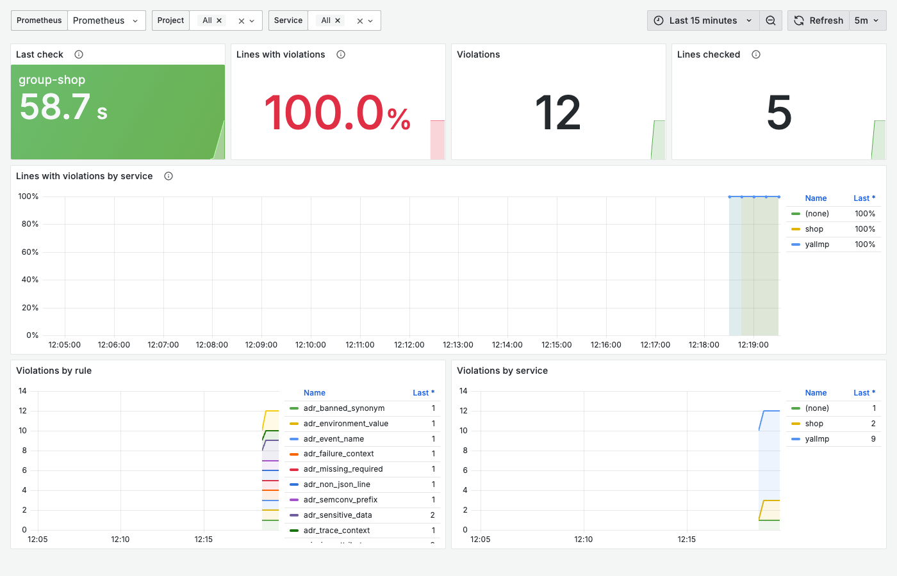

# Start here: logs in Elasticsearch or Kibana

Check what your services already write in production, without changing them. You need the
address of your Elasticsearch, an account that can read the log indices, and Docker.
About 10 minutes.

## 1. Fetch the last hour

```bash
export LOGWARDEN_ES_AUTH='user:password'      # or 'ApiKey <base64 of id:api_key>'
docker run --rm -e LOGWARDEN_ES_AUTH -v "$PWD:/work" ghcr.io/ingeniator/logwarden:0.10.3 \
  fetch --es https://elasticsearch.example.com:9200 --index 'logs-*' --since 1h
```

- `--index` is the index pattern or data stream your logs are in (Kibana: *Stack Management →
  Data Views* shows it). Add `--query 'kubernetes.namespace_name:shop'` to take one team's
  services only.
- It writes the newest 10,000 lines (at most) to `logwarden-es.json`. When more lines matched,
  the report says it's a sample.
- If Elasticsearch runs on this machine, add `--network host` after `docker run` (Linux), or use
  `http://host.docker.internal:9200` (Docker Desktop). A private CA: mount it and add `--ca`.

`logwarden-es.json` holds the logged values. Keep it on your machine and delete it when you're done.

## 2. Check it

Open one log document in Kibana's Discover and look at how the service's JSON line is stored:

- **As a string in a field**, usually `log` (Fluent Bit, Docker): add `--message-field log`.
- **As fields of the document** (Fluent Bit `Merge_Log`, Filebeat, Elastic agents): nothing to add.

```bash
docker run --rm -v "$PWD:/work" ghcr.io/ingeniator/logwarden:0.10.3 \
  check logwarden-es.json --profile essential --message-field log --html report.html
#                         leave out --message-field log if the fields are in the document ^
```

The check needs no network. It exits with 1 when it found violations (expected on a first run),
0 when there are none, and 2 when something is set up wrong.

`--profile essential` checks the three things every service should pass as it is: no secrets or
personal data, every line is JSON, and every line has `service.name`, `service.version` and
`deployment.environment.name`.

## 3. Read the result

The output starts with **fix first**: the places (a source line, or a logger and event) that
cause most of the lines with violations, and their share. Fixing the top few usually clears most
of them. `report.html` has the same with a breakdown by service.

```text
logwarden: 9312 records, 4120 violations
Profile essential: 22310 more violations under the standard profile (--profile standard).

fix first: the top 3 places cause 81% of the lines with violations
  52.4%	2101 lines	logger shop.api, event request_finished	adr_missing_required ×2101; fields: service.version
  ...
```

Then delete the export: `rm logwarden-es.json`.

## 4. Every hour, with a trend

**GitLab:** add the template's `.logwarden-production` job and a pipeline schedule; see
[GitLab](gitlab.md#production-logs-every-hour).

**cron or a Kubernetes CronJob:** the same two commands, keeping the last snapshot to compare
with and pushing the numbers to a Prometheus Pushgateway. Put in your Elasticsearch address,
index and Pushgateway, set `LOGWARDEN_ES_AUTH` in the job's environment, and add the
`--network` option from step 1 if you needed it there:

```bash
#!/bin/sh
# Every hour: check the last hour, compare with the previous run, push the numbers.
set -e
mkdir -p /var/lib/logwarden && cd /var/lib/logwarden   # keeps last.json between runs
COMPARE=""; [ -f last.json ] && COMPARE="--compare last.json"
docker run --rm -e LOGWARDEN_ES_AUTH -v "$PWD:/work" ghcr.io/ingeniator/logwarden:0.10.3 \
  fetch --es https://elasticsearch.example.com:9200 --index 'logs-*' --since 1h -o es.json
docker run --rm -v "$PWD:/work" ghcr.io/ingeniator/logwarden:0.10.3 \
  check es.json --profile essential --message-field log $COMPARE \
  --snapshot last.json --markdown report.md --html report.html \
  --pushgateway http://pushgateway.example.com:9091 || [ $? -eq 1 ]
rm -f es.json
```

Import [`integrations/grafana/logwarden.json`](https://github.com/Ingeniator/logwarden/blob/main/integrations/grafana/logwarden.json)
into Grafana (*Dashboards → New → Import*, and pick the Prometheus that scrapes the Pushgateway) for the share of lines with violations per service,
violations by rule, and the time of the last check, which shows when the schedule stops.



## Next

- Fix the top places, and watch the share go down.
- When `essential` is clean, move to the full standard in one reviewed change. The summary
  already says how many of the extra findings are fields only your service uses; declare them
  from the same export, in the service's repository:

    ```bash
    docker run --rm -v "$PWD:/work" ghcr.io/ingeniator/logwarden:0.10.3 \
      init --from logwarden-es.json --message-field log
    ```

    It writes `logwarden-fields.yaml` (names and types, no values), lists the fields to rename
    instead, and sets `profile = "standard"` in `logwarden.toml`. Review both and commit them.
- Run the check on your tests too, so new problems don't reach production:
  [GitLab](gitlab.md) or [GitHub](github.md).
