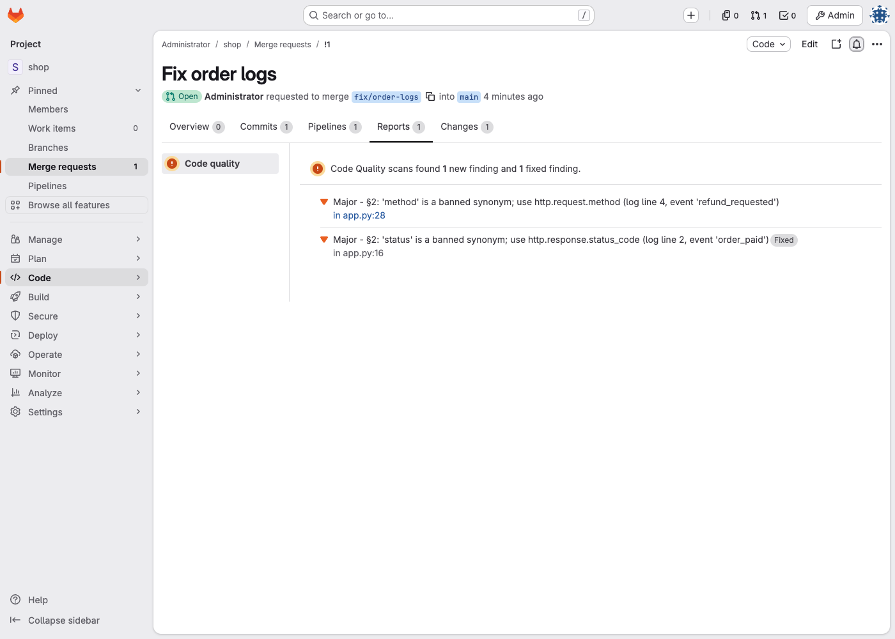

# Start here: GitLab

Check the logs your tests write, and see new and fixed findings in every merge request. The job
runs logwarden's Docker image and needs no internet access. It reports and doesn't block.
About 10 minutes.

## 1. Make the image available

If your runners can pull from `ghcr.io`, skip this step. Otherwise mirror the image into your
registry (on a machine that can reach both):

```bash
docker pull ghcr.io/ingeniator/logwarden:0.9.0
docker tag ghcr.io/ingeniator/logwarden:0.9.0 registry.example.com/mirror/logwarden:0.9.0
docker push registry.example.com/mirror/logwarden:0.9.0
```

Runners without internet access also need GitLab's own helper image in a registry they can
reach, as for any other job.

## 2. Add the template

Save the template in your repository as `ci/logwarden.gitlab-ci.yml`:

```bash
mkdir -p ci
curl -fsSL -o ci/logwarden.gitlab-ci.yml \
  https://raw.githubusercontent.com/Ingeniator/logwarden/v0.9.0/ci/gitlab/logwarden.gitlab-ci.yml
```

And start with the `essential` rules: no secrets or personal data, every line is JSON, and the
required service fields. Create `logwarden.toml` next to `.gitlab-ci.yml`:

```toml
profile = "essential"
```

## 3. Save the test logs

The job checks a file of JSON log lines that your test job keeps as an artifact.

- **Python with pytest:** add `logwarden` to the test dependencies and run
  `LOGWARDEN_CAPTURE=logs.jsonl pytest`. The plugin writes what your own logging setup produces.
- **Anything else:** have the service log JSON to a file during the tests, e.g. by pointing its
  log output at `logs.jsonl`. The [setup recipes](../recipes/node.md) show it for Node, Go and Java.

```yaml
test:
  script:
    - LOGWARDEN_CAPTURE=logs.jsonl pytest
  artifacts:
    when: always
    paths: [logs.jsonl]
```

## 4. Add the job

In `.gitlab-ci.yml`:

```yaml
include:
  - local: ci/logwarden.gitlab-ci.yml

logwarden:
  extends: .logwarden
  needs: [{job: test, artifacts: true}]
  variables:
    # LOGWARDEN_IMAGE: registry.example.com/mirror/logwarden:0.9.0   # if you mirrored it
    LOGWARDEN_LOGS: logs.jsonl
```

Commit and push to the default branch. The pipeline passes with a warning while there are
violations; the job's artifacts hold `report.html` and `report.md`, which start with
**Fix first**: the places that cause most of the violations.

## 5. Open a merge request

Every merge request now compares with the default branch. The **Reports** tab lists new and
fixed findings (Code Quality, on every GitLab tier), and the merge request links the HTML report.



## Production logs every hour

If your logs are in Elasticsearch, the same template checks them on a schedule, without
touching the service:

```yaml
logwarden-production:
  extends: .logwarden-production
  rules: [{if: '$CI_PIPELINE_SOURCE == "schedule"'}]
  variables:
    # LOGWARDEN_IMAGE: registry.example.com/mirror/logwarden:0.9.0
    LOGWARDEN_ES_URL: https://elasticsearch.example.com:9200
    LOGWARDEN_ES_INDEX: "logs-shop-*"
    LOGWARDEN_ARGS: "--message-field log"           # if the JSON line is in a `log` field
    # LOGWARDEN_PUSHGATEWAY: http://pushgateway.example.com:9091
```

Add `LOGWARDEN_ES_AUTH` (`user:password` or `ApiKey …`) under *Settings → CI/CD → Variables*,
masked, and an hourly schedule under *Build → Pipeline schedules*. Each run compares with the
previous one. See [Elasticsearch or Kibana](elasticsearch.md) for the details.

## Next

- Fix the top places in **Fix first**.
- When `essential` is clean, set `profile = "standard"` for the full standard.
- More options: the [integration guide](../integration.md#gitlab-ci).
